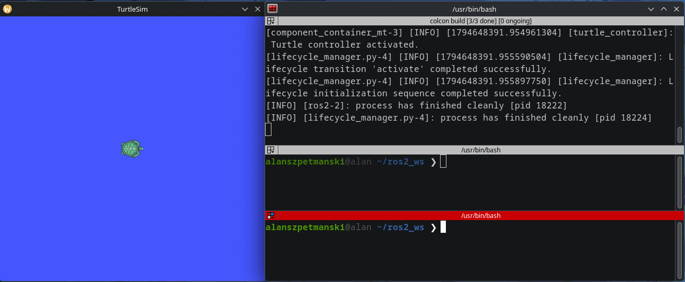
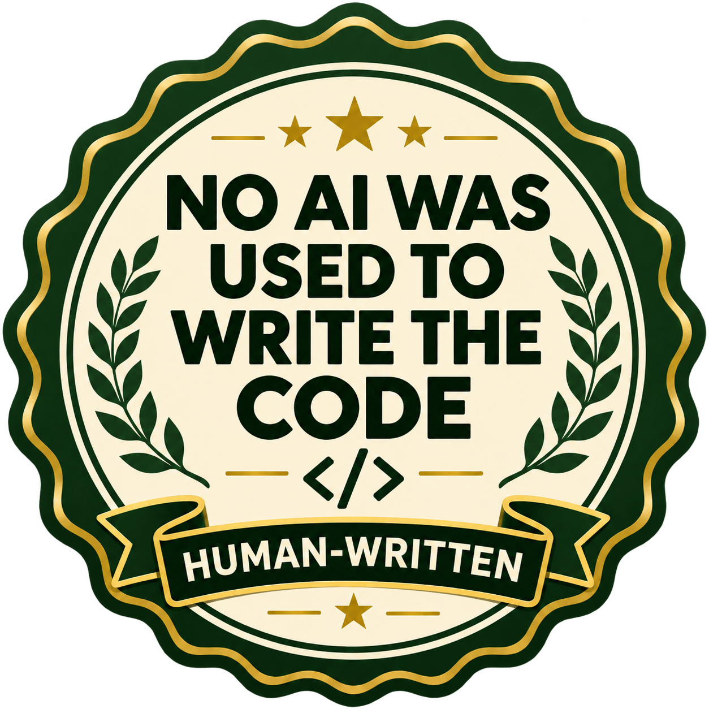

# ROS 2 Lifecycle Turtle Controller

A small ROS 2 project demonstrating how to control a turtle in **turtlesim** using a custom action server, a managed lifecycle node, and a composable C++ component. A Python lifecycle manager automatically configures and activates the controller at startup.

The project focuses on ROS 2 communication patterns and node management rather than navigation or motion planning. Each action goal requests constant linear and angular velocities for a specified duration.

## Demo

<p align="center">
  
</p>

The GIF shows the project running in turtlesim with its custom movement action.

## ROS 2 concepts demonstrated

| Concept | How it is used |
| --- | --- |
| **Lifecycle nodes** (`rclcpp_lifecycle`) | The controller handles configuration, activation, deactivation, cleanup, and shutdown. |
| **Custom actions** (`rclcpp_action`) | `MoveTurtle` accepts motion goals, publishes feedback, supports cancellation, and reports results. |
| **Services** | The controller calls turtlesim's `spawn` and `kill` services. The manager calls the controller's `change_state` service. |
| **Topics** | The controller publishes `geometry_msgs/msg/Twist` velocity commands to `/<turtle_name>/cmd_vel`. |
| **Composition** (`rclcpp_components`) | The C++ controller runs in a multithreaded component container. |
| **Callback groups** | A reentrant callback group allows service and action callbacks to be handled by the multithreaded executor. |
| **Parameters** | `turtle_name` configures the turtle and the action server name; `managed_node_name` tells the manager which node to control. |
| **ROS 2 launch** | One XML launch file starts turtlesim, removes its default turtle, loads the controller, and starts the lifecycle manager. |

## Main components

- **`my_turtle_controller`** — C++ lifecycle component and `MoveTurtle` action server.
- **`my_turtle_bringup`** — launch configuration and Python lifecycle manager.
- **`my_turtle_interfaces`** — defines the movement goal, result, and feedback.

The controller's default turtle name is `alan`. During configuration it requests a turtle at approximately `(5.54, 5.54)`, sets up a velocity publisher, and creates an action server named `/move_turtle_alan`. A valid goal has a positive duration and linear/angular velocity magnitudes no greater than `3.0`.

### Action interface

```text
# Goal: requested velocities and duration.
float32 linear_vel_x
float32 angular_vel_z
int32 duration_s
---
# Result: whether the goal completed successfully.
bool success
---
# Feedback: estimated distance in turtlesim units and remaining seconds.
float32 distance_covered
int32 time_left
```

Distance is estimated from `abs(linear_vel_x) * elapsed_time`, so it is a non-negative distance in **turtlesim units**, not meters. It is not measured from the turtle's actual position. Since `time_left` is an integer, fractional seconds are discarded.

## Requirements

- Linux with a working ROS 2 installation (for example, ROS 2 Jazzy).
- `colcon` and `rosdep`.
- ROS 2 packages including `turtlesim`, `rclcpp`, `rclcpp_lifecycle`, `rclcpp_action`, `rclcpp_components`, `rclpy`, `lifecycle_msgs`, `geometry_msgs`, `action_msgs`, and the launch packages.
- The packages from this repository, including `my_turtle_interfaces`.

## Build

Open a terminal and source your ROS 2 installation (replace `jazzy` with your installed distribution):

```bash
source /opt/ros/jazzy/setup.bash
```

Clone the repository into a workspace:

```bash
mkdir -p ~/ros2_turtle_ws/src
cd ~/ros2_turtle_ws/src
git clone https://github.com/aszpetmanski/my_turtlebot_project.git
```

Install declared dependencies and build:

```bash
cd ~/ros2_turtle_ws
rosdep install --from-paths src --ignore-src -r -y
colcon build --symlink-install
source install/setup.bash
```

Source `install/setup.bash` in **every new terminal** used for the examples below.

## Run

Start the launch file:

```bash
ros2 launch my_turtle_bringup final_project.launch.xml
```

The launch sequence starts turtlesim, sends a request to remove `turtle1`, loads the controller into a multithreaded container, and starts the Python lifecycle manager. The manager requests `configure`, waits briefly, and then requests `activate`.

To inspect the running system from another terminal:

```bash
ros2 node list
ros2 action list -t
ros2 lifecycle get /turtle_controller
```

The lifecycle state should normally be `active`, and the action name should be `/move_turtle_alan`.

## Send a movement goal

Find the exact action type first:

```bash
ros2 action list -t
```

It should appear in the form `/move_turtle_alan [my_turtle_interfaces/action/MoveTurtle]`.

Send a goal for 10 seconds of forward motion with a slight turn, displaying feedback:

```bash
ros2 action send_goal /move_turtle_alan \
  my_turtle_interfaces/action/MoveTurtle \
  "{linear_vel_x: 1.0, angular_vel_z: 0.5, duration_s: 10}" \
  --feedback
```

While the goal runs, feedback includes `distance_covered` and `time_left`. On successful completion the action returns `success: true`. Only one goal is intended to execute at a time; overlapping goals are rejected.

## Cancel an active goal

First send a longer-running goal, such as one with `duration_s: 30`. While it is executing, run this command in **another terminal**:

```bash
ros2 service call /move_turtle_alan/_action/cancel_goal \
  action_msgs/srv/CancelGoal \
  "{goal_info: {goal_id: {uuid: [0, 0, 0, 0, 0, 0, 0, 0, 0, 0, 0, 0, 0, 0, 0, 0]}, stamp: {sec: 0, nanosec: 0}}}"
```

The all-zero UUID and zero timestamp request cancellation of **all goals** on this action server, not just a particular goal. The cancellation response indicates whether any goal was accepted for cancellation. Once the controller processes it, the turtle should stop and the action should finish as canceled.

## Manage the node lifecycle manually

The Python manager automatically configures and activates the node at startup. To experiment with transitions manually, first inspect its current state:

```bash
ros2 lifecycle get /turtle_controller
ros2 lifecycle list /turtle_controller
```

Useful lifecycle transitions:

```bash
# Active -> Inactive
ros2 lifecycle set /turtle_controller deactivate

# Inactive -> Active
ros2 lifecycle set /turtle_controller activate

# Inactive -> Unconfigured
ros2 lifecycle set /turtle_controller cleanup

# Unconfigured -> Inactive
ros2 lifecycle set /turtle_controller configure

# Inactive -> Active
ros2 lifecycle set /turtle_controller activate
```

Run these commands in an appropriate order: for example, **deactivate before cleanup**. `configure` is only valid from the unconfigured state, and `activate` is only valid from the inactive state. 

## Future work: TurtleBot simulation

The same lifecycle and action concepts can be adapted to a TurtleBot simulation. A future version will replace turtlesim-specific spawning and velocity handling with integration appropriate for a simulated mobile robot.

**TurtleBot simulation adaptation:** [Repository link — coming soon](https://github.com/aszpetmanski/my_turtlebot_project_gz)

This follow-up is planned and is **not yet implemented** in this repository.

## Inspiration & credits

This project started as the final challenge from [**ROS 2 for Beginners Level 3 – Advanced Concepts**](https://www.udemy.com/course/ros2-advanced-core-concepts/), a course by [**Edouard Renard**](https://www.udemy.com/user/edouard-renard/).

Credit goes to Edouard for the project idea and for teaching the underlying ROS 2 concepts. **I designed and implemented my own solution to the challenge rather than copying the instructor's implementation.**

<p align="center">
  
</p>
