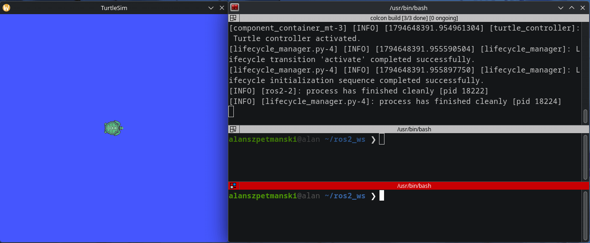
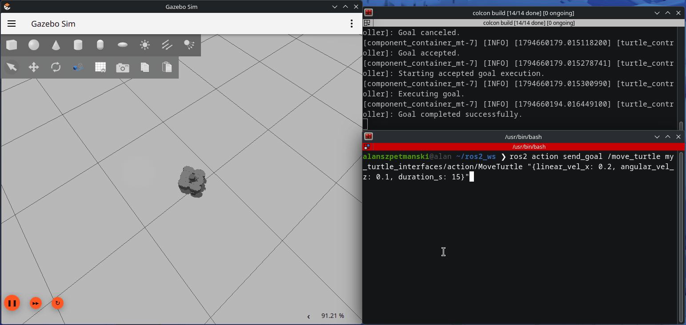
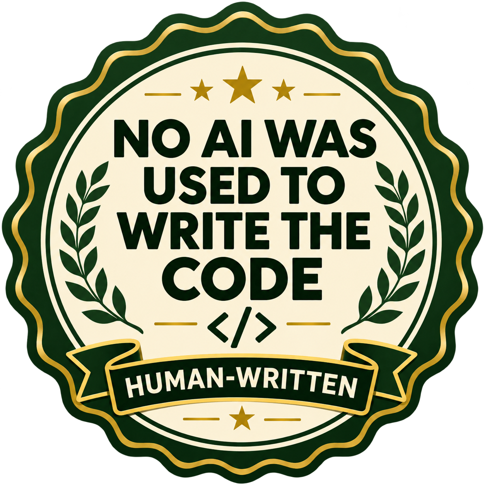

# ROS 2 Lifecycle Turtle Controller — turtlesim & TurtleBot3 Gazebo

A small ROS 2 project demonstrating how to control a turtle in **turtlesim** or a **TurtleBot3 Waffle Pi in Gazebo** using a custom action server, a managed lifecycle node, and a composable C++ component. A Python lifecycle manager automatically configures and activates the controller at startup.

Both simulations live in **the same repository** and share the `MoveTurtle` action interface. Choose which one to run by starting its corresponding launch file.

The project focuses on ROS 2 communication patterns and node management rather than navigation or motion planning. Each action goal requests constant linear and angular velocities for a specified duration. The Gazebo controller also uses **odometry feedback** to track the actual distance traveled during a goal.

## Demos

### turtlesim

<p align="center">
  
</p>

### TurtleBot3 Waffle Pi in Gazebo

<p align="center">
  
</p>

The same action-based movement concept works in both environments. In Gazebo, the robot is launched by `turtlebot3_gazebo` rather than spawned and removed by the controller.

## ROS 2 concepts demonstrated

| Concept | How it is used |
| --- | --- |
| **Lifecycle nodes** (`rclcpp_lifecycle`) | The controllers handle configuration, activation, deactivation, cleanup, and shutdown. |
| **Custom actions** (`rclcpp_action`) | `MoveTurtle` accepts motion goals, publishes feedback, supports cancellation, and reports results. |
| **Services** | The turtlesim controller calls `spawn` and `kill`; the lifecycle manager calls the controller's `change_state` service. The Gazebo controller does not need turtle spawning services. |
| **Topics** | turtlesim publishes `geometry_msgs/msg/Twist` to `/<turtle_name>/cmd_vel`; Gazebo publishes `geometry_msgs/msg/TwistStamped` to `/cmd_vel` and subscribes to `nav_msgs/msg/Odometry` on `/odom`. |
| **Odometry** | The Gazebo controller uses successive `/odom` positions to accumulate distance traveled while an action goal is active. |
| **Composition** (`rclcpp_components`) | The selected C++ controller runs in a multithreaded component container. |
| **Callback groups** | Callback groups coordinate execution of controller callbacks in the multithreaded executor. |
| **Parameters** | `turtle_name` configures the turtlesim turtle and action name; `managed_node_name` tells the manager which lifecycle node to control. |
| **ROS 2 launch** | Separate XML launch files start either turtlesim or Gazebo, load the appropriate controller, and start the lifecycle manager. |

## Main components

- **`my_turtle_controller`** — C++ lifecycle controller components, including the Gazebo-specific `my_turtle_controller_gz::TurtleController`, and a `MoveTurtle` action server.
- **`my_turtle_bringup`** — launch files and the Python lifecycle manager.
- **`my_turtle_interfaces`** — shared action definition for movement goals, results, and feedback.

### Simulation variants

| | turtlesim | TurtleBot3 Gazebo |
| --- | --- | --- |
| Simulated model | A turtle named `alan` by default | TurtleBot3 `waffle_pi` |
| Launch file | `final_project.launch.xml` | `final_project_gz.launch.xml` |
| Action server | `/move_turtle_alan` | `/move_turtle` |
| Velocity topic | `/alan/cmd_vel` | `/cmd_vel` |
| Velocity message | `geometry_msgs/msg/Twist` | `geometry_msgs/msg/TwistStamped` |
| Distance feedback | Estimate based on requested linear velocity and elapsed time | Integrated distance from `/odom` position updates |
| Model setup | Controller spawns the turtle near `(5.54, 5.54)` during configuration | TurtleBot3 Gazebo launch starts the robot; the controller does not spawn or kill it |

The action interface and lifecycle manager are reused, while the controller implementation and velocity topic match the selected simulation.

### Action interface

```text
# Goal: requested velocities and duration.
float32 linear_vel_x
float32 angular_vel_z
int32 duration_s
---
# Result: whether the goal completed successfully.
bool success
---
# Feedback: traveled distance and remaining seconds.
float32 distance_covered
int32 time_left
```

A valid goal has a positive duration and linear/angular velocity magnitudes no greater than `3.0`. Only one goal is intended to execute at a time; overlapping goals are rejected.

`distance_covered` is calculated differently in each simulation:

- **turtlesim:** estimated as `abs(linear_vel_x) * elapsed_time`, in turtlesim distance units.
- **Gazebo:** calculated from odometry by summing the planar distance between consecutive positions received on `/odom` while a goal is active. This measures the simulated robot's traveled path rather than estimating it from the commanded velocity.

The integer `time_left` discards fractional seconds.

#### Gazebo odometry feedback

The Gazebo controller subscribes to `/odom` (`nav_msgs/msg/Odometry`) and stores the latest position. For each new position while a goal is active, it accumulates:

```text
dx = current_x - previous_x
dy = current_y - previous_y
distance_covered += hypot(dx, dy)
```

The previous position is updated on every odometry message, including when no goal is running, so movement outside a goal is not continuously added to the reported distance. The controller requires an odometry message before accepting a movement goal; if odometry has not arrived yet, it rejects the goal.

This uses the robot's 2D odometry position (`x`, `y`), not wheel rotations or the commanded velocity. Like any odometry-based measurement, its accuracy depends on the quality and frequency of the published odometry.

## Requirements

- Linux with a working ROS 2 installation (for example, ROS 2 Jazzy).
- `colcon` and `rosdep`.
- ROS 2 packages including `rclcpp`, `rclcpp_lifecycle`, `rclcpp_action`, `rclcpp_components`, `rclpy`, `lifecycle_msgs`, `geometry_msgs`, `nav_msgs`, `action_msgs`, and the launch packages.
- `turtlesim` for the turtlesim variant.
- `turtlebot3_gazebo` and its TurtleBot3 simulation dependencies for the Gazebo variant, including the odometry publisher/bridge.
- The packages from this repository, including `my_turtle_interfaces`.

## Build

Open a terminal and source your ROS 2 installation (replace `jazzy` with your installed distribution):

```bash
source /opt/ros/jazzy/setup.bash
```

Clone this repository into a workspace:

```bash
mkdir -p ~/ros2_turtle_ws/src
cd ~/ros2_turtle_ws/src
git clone https://github.com/aszpetmanski/my_turtlebot_project.git
```

Install declared dependencies and build:

```bash
cd ~/ros2_turtle_ws
rosdep install --from-paths src --ignore-src -r -y
colcon build --symlink-install
source install/setup.bash
```

Source `install/setup.bash` in **every new terminal** used for the examples below.

## Run

Choose one simulation and launch it from a terminal in which the workspace is sourced.

### Option 1: turtlesim

```bash
ros2 launch my_turtle_bringup final_project.launch.xml
```

This starts turtlesim, requests removal of its default `turtle1`, loads the turtlesim controller into a multithreaded component container, and starts the lifecycle manager. During configuration, the controller creates the turtle `alan` and the `/move_turtle_alan` action server.

### Option 2: TurtleBot3 Waffle Pi in Gazebo

```bash
ros2 launch my_turtle_bringup final_project_gz.launch.xml
```

This launch file sets `TURTLEBOT3_MODEL=waffle_pi`, includes `turtlebot3_gazebo`'s `empty_world.launch.py`, loads the `my_turtle_controller_gz::TurtleController` component into a multithreaded container, and starts the **same Python lifecycle manager**.

Unlike the turtlesim version, the Gazebo controller does not call `spawn` or `kill`. It sends stamped velocity commands to `/cmd_vel`, listens for odometry on `/odom`, and exposes the action server as `/move_turtle`.

For **either** launch, the manager requests `configure`, waits briefly, then requests `activate`. Check the system from another sourced terminal:

```bash
ros2 node list
ros2 action list -t
ros2 lifecycle get /turtle_controller
```

The lifecycle node should normally be `active`. The action list should show `/move_turtle_alan` for turtlesim or `/move_turtle` for Gazebo.

For Gazebo, check that odometry is available before sending a goal:

```bash
ros2 topic echo /odom --once
```

## Send a movement goal

First check the available action name and type:

```bash
ros2 action list -t
```

The type is `my_turtle_interfaces/action/MoveTurtle` in both variants.

### turtlesim example

Move forward for 10 seconds with a slight turn, displaying feedback:

```bash
ros2 action send_goal /move_turtle_alan \
  my_turtle_interfaces/action/MoveTurtle \
  "{linear_vel_x: 1.0, angular_vel_z: 0.5, duration_s: 10}" \
  --feedback
```

### Gazebo example

Send a gentler movement command to the TurtleBot3 Waffle Pi:

```bash
ros2 action send_goal /move_turtle \
  my_turtle_interfaces/action/MoveTurtle \
  "{linear_vel_x: 0.2, angular_vel_z: 0.1, duration_s: 15}" \
  --feedback
```

While either goal runs, feedback includes `distance_covered` and `time_left`. For Gazebo, `distance_covered` comes from the odometry readings. On successful completion, the action returns `success: true` and the controller sends a stop command.

## Cancel an active goal

First send a longer-running goal, such as one with `duration_s: 30`. While it is executing, run the following command in **another terminal** for the Gazebo action:

```bash
ros2 service call /move_turtle/_action/cancel_goal \
  action_msgs/srv/CancelGoal \
  "{goal_info: {goal_id: {uuid: [0, 0, 0, 0, 0, 0, 0, 0, 0, 0, 0, 0, 0, 0, 0, 0]}, stamp: {sec: 0, nanosec: 0}}}"
```

For turtlesim, use `/move_turtle_alan/_action/cancel_goal` instead.

The all-zero UUID and zero timestamp request cancellation of **all goals** on that action server, not just a particular goal. The response indicates whether any goal was accepted for cancellation. Once the controller processes it, the robot should stop and the action should finish as canceled.

## Manage the node lifecycle manually

The Python manager automatically configures and activates the controller at startup in **both simulations**. To experiment with transitions manually, first inspect its current state:

```bash
ros2 lifecycle get /turtle_controller
ros2 lifecycle list /turtle_controller
```

Useful lifecycle transitions:

```bash
# Active -> Inactive
ros2 lifecycle set /turtle_controller deactivate

# Inactive -> Active
ros2 lifecycle set /turtle_controller activate

# Inactive -> Unconfigured
ros2 lifecycle set /turtle_controller cleanup

# Unconfigured -> Inactive
ros2 lifecycle set /turtle_controller configure

# Inactive -> Active
ros2 lifecycle set /turtle_controller activate
```

Run these commands in an appropriate order: for example, **deactivate before cleanup**. `configure` is only valid from the unconfigured state, and `activate` is only valid from the inactive state.

## TurtleBot3 Gazebo adaptation

The Gazebo variant extends the original turtlesim exercise **within this repository**, keeping the shared action interface, composable-node architecture, and automatic lifecycle management.

The main differences are that the launch file starts a TurtleBot3 Waffle Pi in Gazebo, the controller no longer creates or removes a turtle, movement commands are published as `TwistStamped` messages to `/cmd_vel`, and movement feedback is calculated using `/odom`. It is still a timed velocity controller, not a navigation or motion-planning system.

## Inspiration & credits

This project started as the final challenge from [**ROS 2 for Beginners Level 3 – Advanced Concepts**](https://www.udemy.com/course/ros2-advanced-core-concepts/), a course by [**Edouard Renard**](https://www.udemy.com/user/edouard-renard/).

Credit goes to Edouard for the project idea and for teaching the underlying ROS 2 concepts. **I designed and implemented my own solution to the challenge rather than copying the instructor's implementation.**

<p align="center">
  
</p>
